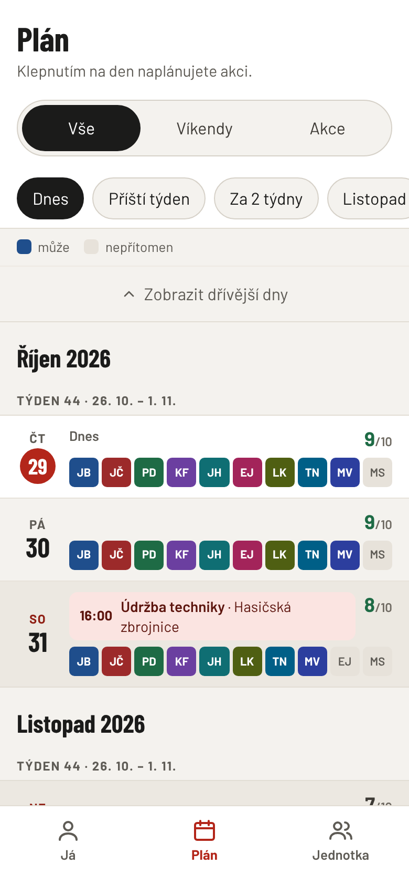
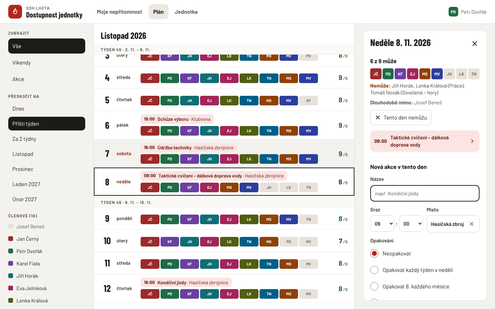
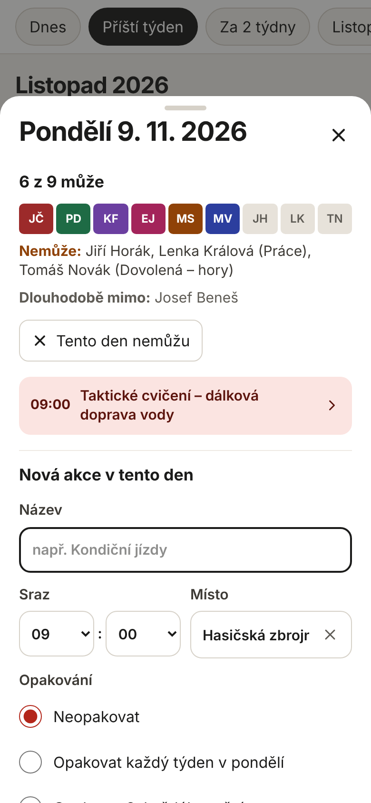
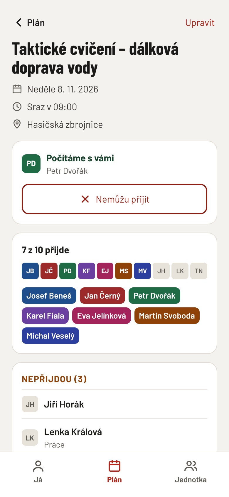
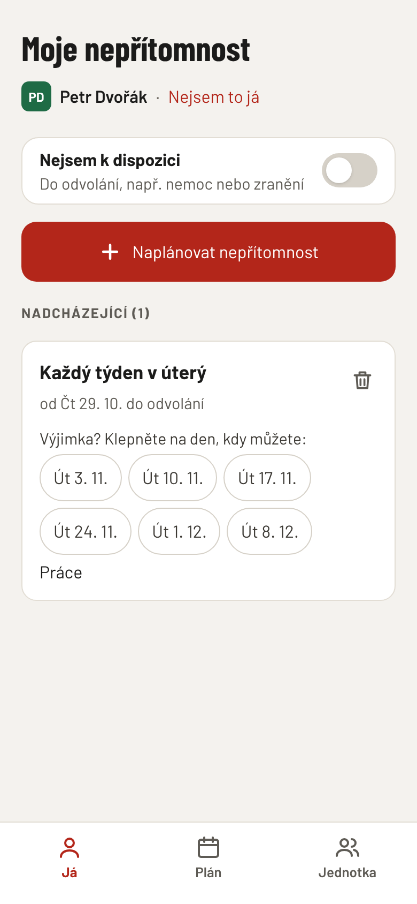
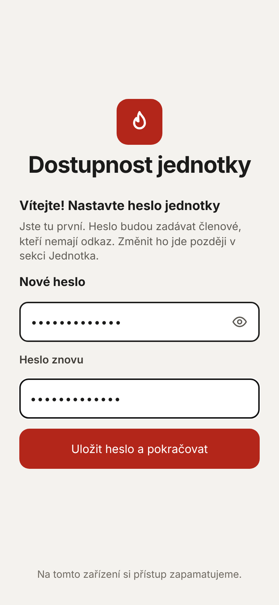
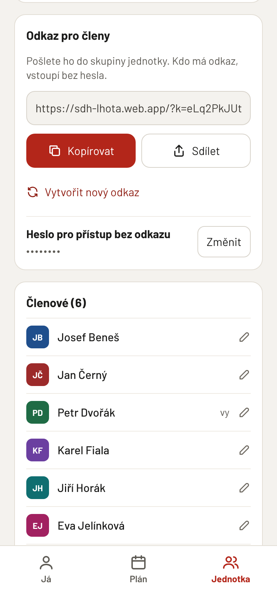
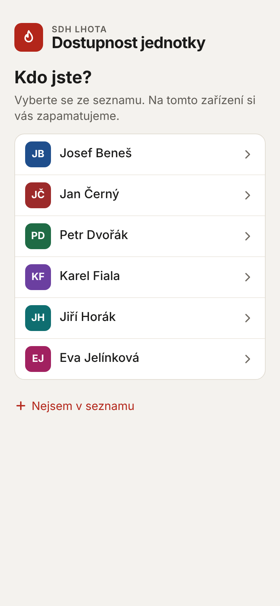
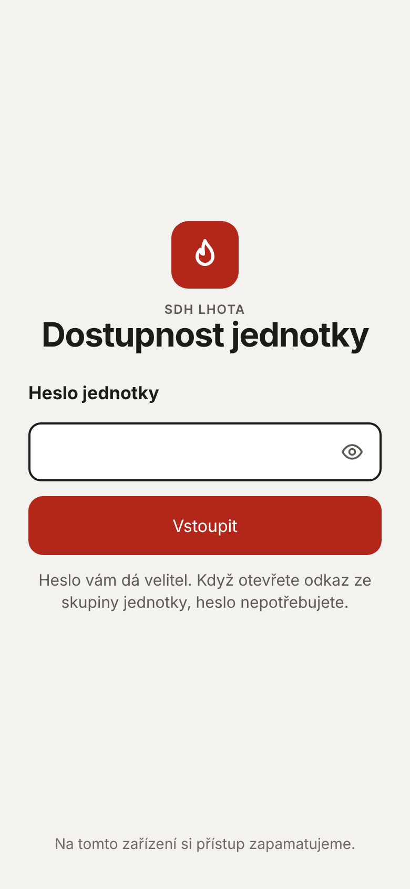

<p align="center">
  
</p>

<h1 align="center">Dostupnost jednotky</h1>

<h3 align="center">Vyrobeno s ❤️ a 🔥 u Hasičů Březová-Oleško</h3>

<p align="center">
  Kdo může přijít, na jedno podívání. Zdarma pro všechny jednotky.
</p>

Jednoduchá webová aplikace pro jednotky sboru dobrovolných hasičů (SDH). Členové si
zapíšou dny, kdy nemůžou, a velitel i ostatní hned vidí, kolik lidí je který den
k dispozici. Do stejného plánu se zapisují akce: cvičení, kondiční jízdy, školení,
schůze.

Aplikace funguje v telefonu i na počítači, nic se neinstaluje z obchodu a nikdo si
nezakládá účet. Je zdarma a každá jednotka si ji provozuje sama na svém (bezplatném)
účtu Google Firebase.

<p>
  
  &nbsp;
  
</p>

Aplikace doplňuje systémy pro výjezdy (např. FIREPORT), nenahrazuje je. Neposílá žádná
upozornění ani e‑maily: kdo chce vědět, podívá se.

## Obsah

- [Co aplikace umí](#co-aplikace-umí)
- [Než začnete](#než-začnete)
- [Návod na zprovoznění](#návod-na-zprovoznění)
- [Jak se připojí ostatní členové](#jak-se-připojí-ostatní-členové)
- [Ikona na ploše telefonu](#ikona-na-ploše-telefonu)
- [Nová verze aplikace](#nová-verze-aplikace)
- [Když něco nejde](#když-něco-nejde)
- [Bezpečnost a soukromí](#bezpečnost-a-soukromí)
- [Pro vývojáře](#pro-vývojáře)

## Co aplikace umí

**Plán.** Dny pod sebou jako v kalendáři. U každého dne je řada barevných políček,
jedno za každého člena: barevné = může přijít, šedé = nemůže. Číslo vpravo („7/10“)
říká, kolik lidí ten den může. Svátky a víkendy jsou zvýrazněné. Tlačítky nahoře se
skočí na dnešek, příští týden nebo další měsíce a filtr ukáže jen víkendy nebo jen dny
s akcí.

**Den.** Klepnutím na den se otevře přehled: kdo může, kdo ne a proč (např.
„Dovolená“). Tady jde jedním tlačítkem zapsat „Tento den nemůžu“ a založit novou akci.

<p>
  
  &nbsp;
  
  &nbsp;
  
</p>

**Akce.** Název, čas srazu, místo a poznámka. Akce se může opakovat: každý týden,
každý měsíc, nebo podle vlastního pravidla (např. každý první pátek v měsíci). Jeden termín
opakované akce jde přesunout nebo zrušit zvlášť. U akce je vidět, kdo přijde a kdo ne,
a každý může klepnout na „Nemůžu přijít“.

**Moje nepřítomnost.** Každý si zapíše, kdy nemůže: jeden den, několik dní za sebou
(dovolená), nebo pravidelně (např. „každé úterý – práce“). Přepínač „Nejsem
k dispozici“ platí do odvolání, třeba při nemoci nebo zranění. Pro jednotlivé dny jde
udělat výjimku.

**Jednotka.** Název jednotky, odkaz pro členy, heslo, seznam členů (přidat,
přejmenovat, změnit barvu, archivovat), přehled nadcházejících nepřítomností a akcí
a seznam míst, kde se akce konají.

Dále:

- Všechno se ukládá hned a ostatní to vidí během vteřiny.
- Funguje i se špatným signálem; naposledy načtený plán se ukáže i bez připojení.
- Velké písmo: aplikace se přizpůsobí, i když má telefon nastavené zvětšené písmo.
- Správcem je každý člen. Není tu žádný „admin“, kterému by se muselo volat.
- Nové verze se do telefonů načtou samy.

## Než začnete

Budete potřebovat:

- **Účet Google** (Gmail). Nejlépe společný účet jednotky, ne osobní, ať aplikace
  nezmizí, když někdo odejde.
- **Počítač** s Windows nebo macOS a připojením k internetu. Potřeba je jen pro
  zprovoznění a pro nahrání nové verze; pak už se používá jen telefon nebo prohlížeč.
- **Asi 30–45 minut** času.

**Kolik to stojí:** nic. Aplikace běží na bezplatném tarifu Firebase „Spark“, který
nevyžaduje platební kartu. Pro jednotku s desítkami členů jsou limity zdarma víc než
dostatečné. Kdyby se někdy překročily, aplikace do druhého dne přestane fungovat, ale
nic se nezaplatí.

> **Na placený tarif „Blaze“ nepřecházejte.** Aplikace potřebuje jen tři věci, které
> jsou na Sparku zdarma: **Firestore Database** (edice Standard), **Authentication**
> (anonymní přihlášení) a **Hosting**. Pokud vás konzole Firebase žádá o přechod na
> Blaze nebo o platební kartu, klikli jste na něco navíc. Typicky jde o **Storage**,
> **Functions**, **App Hosting** (to je jiná služba než Hosting), edici **Enterprise**
> u Firestore nebo funkce s AI (Gemini). Nic z toho aplikace nepotřebuje, takže
> nabídku zavřete a pokračujte podle návodu.
>
> Jaký tarif projekt má, uvidíte vlevo dole v konzoli (**Spark** / **Blaze**). Projekt,
> který už na Blaze přešel, jde vrátit: **Usage and billing** → **Details & settings**
> → **Modify plan** → **Spark**. Pokud Firebase při vracení hlásí, že projekt používá
> službu jen pro Blaze, nejdřív tu službu v konzoli vypněte nebo smažte.

**Jedna instalace = jedna jednotka.** Každá jednotka má vlastní adresu, vlastní data
a vlastní heslo. Data jiných jednotek nikdo nevidí.

## Návod na zprovoznění

Konzole Firebase je v angličtině. U každého kroku proto uvádíme přesný anglický
název tlačítka. Google konzoli občas přeuspořádá; pokud položku v menu nevidíte,
napište její název (např. „Firestore“) do vyhledávání nahoře v konzoli.

### 1. Založte projekt Firebase

1. Otevřete <https://console.firebase.google.com> a přihlaste se účtem Google.
2. Klikněte na **Create a Firebase project** (nebo **Add project**).
3. Napište název, např. `sdh-lhota`. Pod názvem se ukáže **ID projektu**; z něj bude
   adresa aplikace, např. `https://sdh-lhota.web.app`. ID se už nedá změnit. Pokud je
   obsazené, Firebase přidá na konec čísla; ID můžete upravit kliknutím na tužku.
4. Potvrďte podmínky a klikněte na **Continue**.
5. **Gemini** a **Google Analytics** nejsou potřeba, obojí vypněte a klikněte na
   **Create project**. Po chvíli klikněte na **Continue**.

### 2. Zapněte databázi

1. V levém menu otevřete **Databases & Storage** (ve starší podobě konzole **Build**)
   → **Firestore Database** a klikněte na **Create database**.
2. Edici nechte **Standard edition** (edice Enterprise je jen pro placený tarif)
   → **Next**.
3. **Location:** vyberte `eur3 (Europe)` nebo `europe-west3 (Frankfurt)`. Data pak
   zůstanou v Evropské unii. Umístění se později nedá změnit. → **Next**.
4. Nechte vybrané **Start in production mode** a klikněte na **Create**.

### 3. Zapněte přihlašování bez účtu

Aplikace pozná zařízení pomocí „anonymního přihlášení“. Členové nic nevyplňují, jen
to musí být zapnuté.

1. V levém menu otevřete **Security** (ve starší podobě **Build**) → **Authentication**
   a klikněte na **Get started**.
2. Na kartě **Sign-in method** klikněte na **Anonymous**.
3. Zapněte přepínač **Enable** a klikněte na **Save**.

### 4. Přidejte webovou aplikaci

1. Klikněte vlevo nahoře na ozubené kolo vedle **Project Overview** →
   **Project settings**.
2. Dole v části **Your apps** klikněte na ikonu **`</>`** (Web).
3. **App nickname:** napište `Hasiči`.
4. **Zaškrtněte** políčko **Also set up Firebase Hosting for this app**.
5. Klikněte na **Register app**. Další obrazovky jen odklikejte (**Next**, **Next**,
   **Continue to console**). Nic z nich nemusíte kopírovat, o to se postará
   instalační příkaz.

### 5. Nainstalujte Node.js

Node.js je program, který na vašem počítači připraví aplikaci a nahraje ji do Firebase.

1. Otevřete <https://nodejs.org> a stáhněte verzi označenou **LTS**.
2. Nainstalujte ji (pořád **Next** / **Pokračovat**, nic neměňte).
3. Pokud jste měli otevřený příkazový řádek nebo Terminál, zavřete ho.

### 6. Stáhněte aplikaci

1. Na stránce tohoto projektu na GitHubu klikněte na zelené tlačítko **Code** →
   **Download ZIP**.
2. Stažený soubor rozbalte, např. do složky `Dokumenty\hasici`. (Windows: pravým
   tlačítkem na soubor → **Extrahovat vše**. Mac: dvojklik.)

### 7. Spusťte instalaci

Otevřete v rozbalené složce příkazový řádek:

- **Windows:** otevřete složku `hasici` (tu, ve které je soubor `package.json`).
  Klikněte do adresního řádku nahoře v okně složky, napište `cmd` a stiskněte
  **Enter**. Otevře se černé okno.
- **Mac:** v aplikaci Finder klikněte na složku `hasici` pravým tlačítkem →
  **Služby** → **Nový Terminál ve složce**. (Pokud tam položka není: otevřete
  aplikaci **Terminál**, napište `cd ` s mezerou na konci, myší přetáhněte složku
  do okna Terminálu a stiskněte **Enter**.)

Do okna napište tento příkaz a stiskněte **Enter**:

```
npm run setup
```

Instalace vás provede pěti kroky:

1. **Instalace knihoven** – pár minut se stahuje, stačí počkat.
2. **Přihlášení do Firebase** – otevře se prohlížeč. Přihlaste se **stejným účtem
   Google** jako v kroku 1 a povolte přístup. Na otázky v černém okně (sběr údajů,
   Gemini) můžete odpovědět `n` a **Enter**.
3. **Výběr projektu** – napište číslo svého projektu a stiskněte **Enter**.
4. **Nastavení aplikace** – proběhne samo.
5. **Sestavení a nahrání na web** – proběhne samo.

Na konci uvidíte:

```
✔ Hotovo. Aplikace běží na:

    https://sdh-lhota.web.app
```

### 8. Nastavte heslo jednotky (hned!)

Otevřete adresu z předchozího kroku. **Kdo ji otevře jako první, nastaví heslo
jednotky**, proto to udělejte hned a adresu zatím nikomu neposílejte.

1. Zvolte heslo a napište ho dvakrát. Heslo budou zadávat členové, kteří nemají
   odkaz. Použijte aspoň 8 znaků, ne název obce ani „hasici“.
2. Na obrazovce **Kdo jste?** napište své jméno a příjmení a klikněte na **Přidat
   a pokračovat**.

<p>
  
</p>

### 9. Doplňte jednotku

Otevřete záložku **Jednotka**:

1. Do **Název jednotky** napište např. „SDH Lhota“.
2. V části **Členové** přidejte ostatní členy jménem a příjmením. Každý dostane
   vlastní barvu.
3. V části **Místa akcí** můžete zapsat místa, kam se obvykle jezdí (zbrojnice,
   cvičiště…). Při zakládání akce se pak nabízejí.
4. V části **Odkaz pro členy** klikněte na **Kopírovat** nebo **Sdílet** a pošlete
   odkaz do skupiny jednotky (WhatsApp, Messenger, SMS…).

<p>
  
</p>

Hotovo. Aplikace běží a o nic dalšího se starat nemusíte.

## Jak se připojí ostatní členové

- **S odkazem:** člen klepne na odkaz ze skupiny. Heslo nezadává.
- **Bez odkazu:** člen otevře adresu aplikace (např. `https://sdh-lhota.web.app`)
  a zadá heslo jednotky.

Pak jen jednou vybere ze seznamu sám sebe („Kdo jste?“). Pokud v seznamu není, klepne
na **Nejsem v seznamu** a přidá se. Telefon si přístup i jméno zapamatuje, příště se
aplikace rovnou otevře.

<p>
  
  &nbsp;
  
</p>

Kdo omylem vybral špatné jméno, klepne na **Já** → **Nejsem to já**.

## Ikona na ploše telefonu

Aplikaci jde přidat na plochu telefonu. Pak se otevírá jako běžná aplikace.

- **iPhone (Safari):** otevřete aplikaci → tlačítko **Sdílet** (čtvereček se šipkou)
  → **Přidat na plochu**. Aplikace z plochy se na iPhonu jednou zeptá na heslo,
  protože odkaz se vždy otevře v Safari.
- **Android (Chrome):** otevřete aplikaci → menu **⋮** → **Přidat na plochu** nebo
  **Instalovat aplikaci**.

## Nová verze aplikace

Když vyjde nová verze a chcete ji mít:

1. Stáhněte znovu ZIP (krok 6) a rozbalte ho do nové složky.
2. V nové složce otevřete příkazový řádek (krok 7) a spusťte `npm run setup`.
   Vyberte **stejný projekt** jako minule.

Data (členové, nepřítomnosti, akce) zůstávají ve Firebase a nová verze je převezme.
Telefony si novou verzi načtou samy během pár minut.

Pokud máte ve složce soubor `.env` z minula, stačí místo `npm run setup` příkaz
`npm run deploy`.

## Když něco nejde

**„npm“ není rozpoznán jako příkaz** / **command not found: npm**
Node.js není nainstalovaný, nebo bylo okno otevřené už před instalací. Zavřete okno,
případně restartujte počítač a otevřete ho znovu (krok 7).

**Aplikace píše „Nepodařilo se připojit“**
Nejčastěji není zapnuté anonymní přihlášení (krok 3). Zapněte ho a stránku obnovte.

**Instalace píše, že projekt nemá databázi Firestore**
Vraťte se ke kroku 2 a pak spusťte `npm run setup` znovu.

**Instalace skončila chybou u nahrávání (Hosting)**
Zkontrolujte, že jste v kroku 4 zaškrtli **Also set up Firebase Hosting**. Pokud ne:
v konzoli Firebase otevřete **Hosting** → **Get started**, odklikejte průvodce
a spusťte `npm run setup` znovu.

**Zapomněli jsme heslo**
Kdokoli, komu už aplikace funguje, ho změní v záložce **Jednotka** → **Heslo pro
přístup bez odkazu** → **Změnit**. Původní heslo k tomu znát nemusí.

**Heslo nastavil někdo cizí, nebo už nikdo nemá přístup**
V konzoli Firebase otevřete **Firestore Database**, kolekci `config` a smažte
dokumenty `access` a `public` (tři tečky → **Delete document**). Pak otevřete adresu
aplikace a nastavte heslo znovu. Členové, nepřítomnosti a akce zůstanou.

**Chceme odebrat přístup telefonu, který už nemá mít přístup (ztracený telefon,
odchod z jednotky)**
Nový odkaz ani nové heslo sama o sobě přihlášená zařízení neodpojí. Odpojte je takto:
v konzoli Firebase v **Firestore Database** smažte celou kolekci `sessions`, potom
v aplikaci vytvořte nový odkaz a změňte heslo. Nový odkaz a heslo pošlete jen
současným členům.

## Bezpečnost a soukromí

- Kdo má **odkaz** nebo **heslo**, vidí celý plán a může ho měnit. Odkaz proto
  posílejte jen do uzavřené skupiny jednotky, ne na web nebo veřejný Facebook.
- Aplikace ukládá jen jména členů, jejich nepřítomnosti s případnou poznámkou a akce.
  Do poznámek nepište citlivé údaje (např. diagnózy). Stačí „nemoc“.
- Data jsou uložená ve Firebase (Google) v umístění, které jste zvolili v kroku 2.
  Přístup ke konzoli Firebase má jen účet Google, kterým jste projekt založili (a ti,
  koho do projektu sami přidáte).
- Vyhledávače aplikaci neindexují.

## Pro vývojáře

- SvelteKit (Svelte 5, statická SPA), Tailwind CSS 4, Firebase (Firestore, anonymní
  Auth, Hosting). Podrobný popis návrhu, datového modelu a kódu je v
  [HANDOVER.md](HANDOVER.md).
- `make` vypíše všechny příkazy. Nejdůležitější:
  - `make demo` – aplikace s ukázkovými daty bez Firebase (`/?demo`, `/?demo=30`),
  - `make dev` – aplikace s lokálními emulátory Firebase (potřebuje Javu),
  - `make test-rules` – otestuje `firestore.rules` na emulátorech,
  - `make check`, `make build`, `make deploy`.
- Automatické nasazení z GitHubu (náhled pro každý pull request, ostrá verze po
  sloučení do `main`) se zapne jednorázově příkazem `make setup-ci` (potřebuje
  `gcloud` a `gh`). Bez toho se workflowy v kopiích repozitáře přeskakují.

## Licence

[MIT](LICENSE). Písma Barlow jsou pod licencí SIL Open Font License 1.1
([static/fonts/OFL.txt](static/fonts/OFL.txt)).
